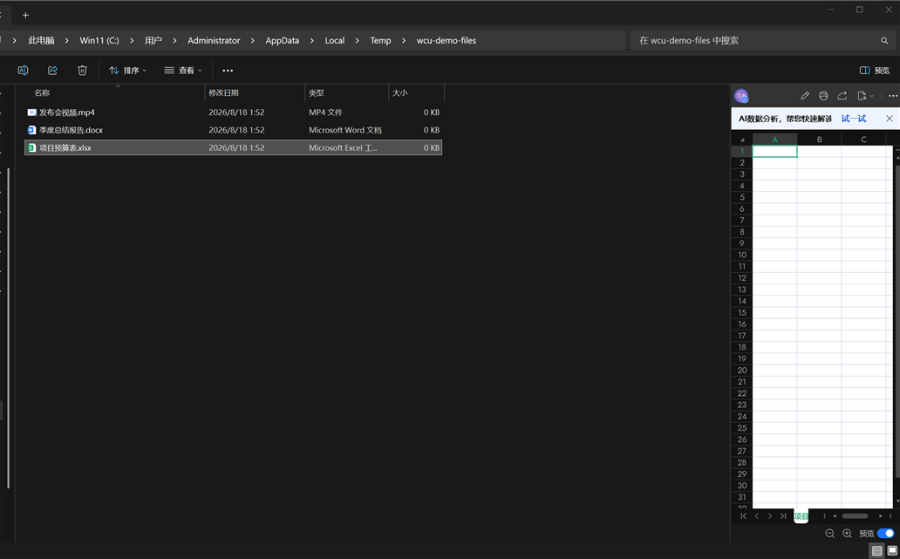
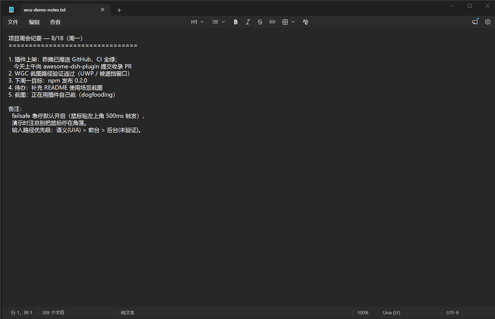
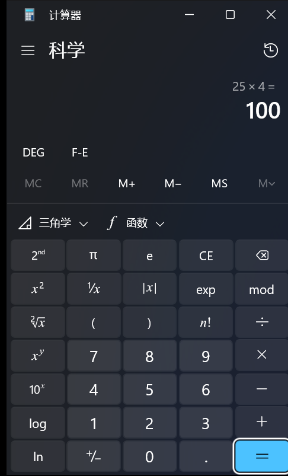

> **本仓库是 [Yu-tao-Li/dsh-computer-use-win](https://github.com/Yu-tao-Li/dsh-computer-use-win) 的 fork（更上游为 [cgissing/windows-computer-use](https://github.com/cgissing/windows-computer-use)），MIT 协议，由 [dxxCaO](https://github.com/dxxCaO) 维护。** 下面一节的英文版见 [README.en.md](README.en.md)。

# wincu —— 给 DeepSeek Harness 用的 Windows 计算机操作插件

[](LICENSE)  

## 这是什么

一个 MCP stdio 服务 + 常驻 PowerShell UIA 后端，让模型能真正操作 Windows：看（无障碍树 / 截图 / OCR）、点（UIA 语义调用 → 后台消息 → 真实输入三级）、敲（快捷键与文本输入，带读回校验）、验（谓词断言与像素变化）。
本 fork（wincu）在保留上游全部能力的前提下，重点做了三件事：**收紧工具面、加固策略层、压缩每步延迟**。

## 相对上游的主要改动

| 方向 | 内容 |
| --- | --- |
| **工具面** | 16 个合并入口（`read` `mouse` `keyboard` `act` `element` `window` `app` `observe` `verify` `cursor` `record` `describe` `status` `clipboard` `wait` `health`）覆盖原先 60+ 个工具；旧名仍可调用但不对外暴露，工具面预算从 ~50 项降到 16 项 |
| **策略层** | 红线拒绝（终端/UAC/凭据等）、危险动作需显式 `approve`、观测绑定（`bindObservation` 严格化）、落点归属校验、前台焦点守卫、失败即拒绝（fail-closed，并回报 `guardsSkipped`） |
| **正确性** | 启动链（`cmd /c start` 优先，绕开 `explorer shell:AppsFolder` 被拒）、目标窗口分层解析（精确 > 前缀 > 子串，排除隐藏 helper 窗）、激活三级阶梯（AttachThreadInput + 置顶往返 + 逐级验证）、元素文本四级回退、区域裁切返回真实裁切文件 |
| **性能** | 后端预热与 kill 后立即重建、能力探测与应用索引缓存、稳定探测从 32 次截图/6s 降到 3 次/0.4s、哈希改算原始像素、`hash` 模式不落盘、虚拟光标静止不重绘 |

## 安装

```bash
dsh plugin add github:dxxCaO/wincu
# 或本地： dsh plugin add file:F:/path/to/wincu
```

前置：Windows 10/11、PowerShell 5.1、peer 依赖 `@deepseek-ai/dsh-mcp-client >= 0.2.0-rc.1`（DSH 自带则可直接用）。

## 设置与配置（全部可选）

| 配置 | 作用 | 默认 |
| --- | --- | --- |
| `WCU_POWERSHELL` / `WINDOWS_CU_POWERSHELL` | 指定 PowerShell 可执行文件（如 `pwsh`） | 自动探测 |
| `WCU_PREWARM=0` | 关闭后端预热（会话初始化时后台启动） | 开启 |
| `WCU_CAPS_TTL_MS` | 能力探测缓存时长（毫秒） | 60000 |
| `WCU_ALLOW_REDLINES=1` | 关闭红线拒绝（谨慎） | 关闭 |
| `WCU_TOOL_GROUPS` | 额外暴露的工具分组 | 空 |
| `WCU_TOOL_BUDGET_CHARS` | 工具面字符预算（CI 会校验） | 20000 |
| `%USERPROFILE%\.dsh\wincu-redlines.json` | 运维自定义红线（进程/窗口/标题模式） | 内置规则 |
| 调用参数 `unsafe:"skip-guards"` | 单次跳过策略守卫（显式、并在结果里回报 `guardsSkipped`） | 不跳过 |

## 质量状态

- 静态守卫 4 项（JS 语法 / PowerShell 契约 / 路由映射 / 工具面预算）
- 表面测试 36 例（含 6 条「必须拒绝」用例：未聚焦输入、落点不属目标、观测失效、未知动作…）
- 上游回归套件 7 个（编码/BOM 契约、自检、profile 解析、激活取消、窗口枚举、窗口契约、输入错误路径）

## 协议与署名

- **MIT License**。原始引擎 © 2026 cgissing（[windows-computer-use](https://github.com/cgissing/windows-computer-use)）；DSH 适配与扩展 © 2026 Yu-tao-Li（[dsh-computer-use-win](https://github.com/Yu-tao-Li/dsh-computer-use-win)）；本 fork 的改动 © 2026 dxxCaO。
- 详细来源拆分见 [THIRD_PARTY.md](THIRD_PARTY.md)。使用本 fork 请保留 `LICENSE` 全文与上述版权声明。

---
# dsh-computer-use-win

[](https://github.com/Yu-tao-Li/dsh-computer-use-win/releases)
[](https://github.com/Yu-tao-Li/dsh-computer-use-win/actions/workflows/ci.yml)
[](LICENSE)

[](https://github.com/Yu-tao-Li/dsh-computer-use-win)

[](https://awesome-dsh-plugin.com)

**给 [DeepSeek Harness](https://github.com/deepseek-ai/deepseek-harness) 装上 Windows 电脑操控能力**——MCP stdio 服务器 + PowerShell/UIA 桌面引擎，22 个工具让 agent 能**看**（UIA 无障碍树、窗口裁剪截图、OCR 词框）也能**做**（鼠标、键盘、UIA 语义动作、窗口管理）真实的 Windows 桌面应用。

通过 DSH 内置的 `@deepseek-ai/dsh-mcp-client` 桥接，**不改 DSH 本体**，零运行时依赖。

| ① 文件资源管理器：`find` 定位 + 语义 `invoke` 选中文件（状态栏"选中 1 个项目"） | ② `type_text` 写入真实文档（剪贴板路径，`verifyValue` 回读） | ③ UWP 计算器：`find` 定位按钮 + 语义 `Invoke` 点击（25×4=100） |
|---|---|---|
|  |  |  |

## 特性

- **文本优先的观察**——UIA 无障碍树三视图（`control`/`content`/`raw`）；按 name/automationId/类名/值找控件，不靠猜像素。元素 id 用 UIA RuntimeId（UI 刷新后仍稳定，过期报 `stale` 而非点错地方）。
- **三级截图链**——`PrintWindow`（非前台窗口也能抓）→ **WGC**（`Windows.Graphics.Capture`，DirectComposition/被遮挡窗口）→ 屏幕区域兜底（带 `occludedPossible` 标记）。窗口裁剪 + 降采样 + `imageScale/origin` 坐标映射，PNG 30 分钟自动清理。
- **三条输入路径，诚实上报**——语义（UIA pattern，不碰鼠标）/ 前台（`SetCursorPos` + SendInput + 剪贴板 / `KEYEVENTF_UNICODE`）/ 后台（PostMessage 直进窗口消息队列，不抢前台；投递未验证，如实 `verified:false`——Chromium/Electron/WinUI 会静默丢合成消息，工具会明说）。
- **UIA 盲区 OCR 回退**——`Windows.Media.Ocr`（csc 编译的 C# WinRT 助手）；返回文字 + 逐词屏幕坐标词框，`query` 命中后自动回查匹配词下的控件（`ControlFromPoint`）。
- **内置安全机制**
  - *坐标 homing*——观察后窗口被移动，点击自动补偿并回报 `homed:{dx,dy}`
  - *急停 failsafe*——物理鼠标停屏幕角落 500ms，所有输入被拒（`EMERGENCY STOP`），只有人把鼠标移开才恢复
  - *identity guard*——按 `windowTitle` 操作时窗口 HWND/PID 变了就拒绝（`identity_changed`）
  - *前台校验*——输入 fail-closed：目标窗口不是真前台就直接报错，绝不打进别的窗口
  - *Win 键黑名单*——`Win+R/X/L/S` 类组合按设计拦截
- **持久化后端**——一个常驻 PowerShell 进程 + JSON 行协议，热态延迟 6–100ms（首次 ~500ms 冷启动）；C# P/Invoke 助手按 hash 编译成缓存 DLL，重启免重编。

## 安装

```powershell
# 从 npm（推荐）
dsh plugin --profile web add dsh-computer-use-win

# 从 GitHub（--profile 指定装进哪个 profile）
dsh plugin --profile web add github:Yu-tao-Li/dsh-computer-use-win
# 或在 DSH 设置的插件市场（dshmarket）搜索 dsh-computer-use-win
```

重启 `dsh web`，工具以 `mcp__wincu__windows_computer_use_*` 出现。

> bundle 在启动时通过所在 profile 的 `package.json` 解析已安装包中的 `server.mjs`，因此适用于任意 profile / `$DSH_HOME`，也兼容 pnpm 布局，无硬编码路径。同一 profile 只保留一个 `serverName: wincu` 行。

## 工具清单（22 个，前缀 `mcp__wincu__`）

| 分组 | 工具 |
|---|---|
| 观察 | `health` · `snapshot`（树+截图）· `accessibility_tree` · `list_windows` · `find` · `element_info` · `ocr` |
| 动作 | `click` · `double_click` · `move` · `drag` · `scroll` · `type_text`（clipboard/sendinput/background）· `keypress` · `focus` · `invoke` · `set_value` |
| 窗口 | `activate_window` · `move_window` · `close_window`（WM_CLOSE，应用可弹保存框否决）· `wait_for` · `wait` |

所有工具都支持可选窗口定位（`windowTitle` 子串 / `processId` / `nativeWindowHandle`）+ `activate: true`；不指定 = 当前前台窗口。`activate` 在影响结果的路径上都会生效（输入类、坐标点击/滚动、`ocr` 截屏、`move_window` 等）；`close_window` 忽略它（WM_CLOSE 后台即可），`activate_window` 恒定激活。各工具的确切语义见 `docs/wiki/mcp-tools.md`。

## 架构

```
DSH agent
   │  模型看到 mcp__wincu__windows_computer_use_* 工具
   ▼
@deepseek-ai/dsh-mcp-client   ← DSH 内置桥接（官方 MCP SDK StdioClientTransport）
   │  JSON-RPC 2.0 over stdio（按行分帧）
   ▼
mcp/server.mjs                ← 本仓库：MCP 服务器（Node ≥22，零依赖）
   │  保活一个持久化后端；JSON 行协议
   ▼
scripts/windows-uia.ps1       ← 本仓库：桌面引擎（PowerShell 5.1 兼容）
   ├─ UI Automation 程序集        → 无障碍树
   ├─ user32 P/Invoke（C# 缓存 DLL）→ 鼠标/键盘/窗口操作
   ├─ Windows.Media.Ocr（C# WinRT）→ OCR
   └─ Windows.Graphics.Capture   → WGC 窗口捕获
```

## 安全与限制

- **动作是真实的**——敏感操作前让 agent 先 `snapshot`；重要窗口用 `windowTitle` 明确限定。
- **WinUI / Chromium / Electron** 会丢弃 PostMessage 合成输入（`verified:false` 是诚实上报，不是成功）。这类目标走前台/剪贴板路径。
- **提权窗口**（UAC/管理员程序）UIA 与合成输入都被 Windows 拦截，读不到也点不了。
- 坐标以**物理像素**为准（显式 Per-Monitor V2 DPI）。
- OCR 对 CJK 按**字符**给词框（引擎特性），点选足够用。
- 仅支持 Windows。

## 开发

```
mcp/server.mjs          MCP stdio 服务器 + 持久化后端管理
scripts/windows-uia.ps1 桌面引擎（one-shot 与 -Persistent 双模式）
test/                   self-test / MCP 协议 / Notepad E2E / 功能综合 / 延迟基准
docs/wiki/              上游架构文档（见 THIRD_PARTY.md）
docs/dev-notes.md       设计原理、踩坑记录、性能数据、测试记录
```

```powershell
node mcp/server.mjs --self-test     # 全栈自检（仅 Windows）
node test/mcp-test.mjs              # initialize → tools/list → tools/call
node test/profile-resolution.mjs    # DSH profile node_modules 路径回归测试
node test/notepad-e2e.mjs           # 真实输入端到端（会开记事本）
```

`npm test` 运行自检、MCP 协议、profile 路径、worker 生命周期、激活取消、窗口枚举/坐标缓存/参数校验及输入错误回归测试。每项测试使用独立进程和临时目录，日志与自检截图留在输出所示目录；不发送物理输入，也不修改已安装的 DSH profile。输入和窗口移动场景使用模拟接口，真实桌面仅用于只读检查。

默认使用 Windows PowerShell 5.1；可设置 `$env:WINDOWS_CU_POWERSHELL = (Get-Command pwsh).Source` 后运行 `npm test` 验证 PowerShell 7。CI（`.github/workflows/ci.yml`）在每次 push/PR 时分别测试这两种运行时。

## 许可

MIT，见 [LICENSE](LICENSE)。本项目是 [cgissing/windows-computer-use](https://github.com/cgissing/windows-computer-use)（MIT）的**衍生作品**，上游版权声明保留于 [THIRD_PARTY.md](THIRD_PARTY.md)。

## 安装

```powershell
dsh plugin --profile web add file:C:/Users/Administrator/.dsh/plugins-src/dsh-computer-use-win
dsh plugin --profile web add @deepseek-ai/dsh-mcp-client@0.2.0-rc.1   # bundle patch 需要它，且必须是 profile 的直接依赖
```

装完重启宿主，然后跑 `node tools/check.mjs` 自检。

## 16 个入口

| 入口 | 模式 |
| --- | --- |
| `read` | window · tree · find · element · query · ocr（可用 `diffAgainst` 只回控件增删改） |
| `mouse` | click · double_click · move · scroll · drag（phase: path/start/step/end） |
| `keyboard` | type（method: clipboard/sendinput/background、delayMs 打字节奏） · press · focus |
| `act` | 做一件事并证明：语义 → 后台 → 前台投递阶梯 + expect 验证 |
| `element` | actions · invoke · set_value · secondary（Expand/Collapse/Scroll/Raise/Select/Default） |
| `window` | list · activate · close · move · transient（目标拥有的菜单/模态） · identity |
| `app` | list · resolve · launch（支持中文名） · kill |
| `observe` | 观测预算：region/clientArea、inline/file/hash/auto、diffOnly、stableMs、includeTree |
| `verify` | predicates（轮询到全部成立） · point（这个屏幕点归谁） |
| `cursor` | 虚拟光标：show/hide/move/click/state/quit（不动真实指针） |
| `record` | start · stop · status · replay（元素指纹重定位、变量替换、outcome drift） |
| `status` | capabilities · doctor · stats · budget · internals |
| `describe` | OCR 优先的视觉回退（自动反色/增对比/2× 放大，可配 VLM） |
| `clipboard` `wait` `health` | 剪贴板、等待、存活探测 |

52 个细粒度旧名**仍然可调用**（只是不再出现在 `tools/list`）；引擎动作一个没动。逐条细节见 [docs/history.md](docs/history.md)。

## 关键性质

- **先看后做**：`bindObservation:true` 时动作必须携带有效 `observationId`，过期或串目标一律拒绝。
- **不静默纠偏**：`homing` 默认 strict —— 窗口移动过就报 `window_moved`，而不是照旧坐标点下去。
- **点了不等于生效**：`act` 逐级投递并验证；提交类输入自动等画面稳定并回报 `settle.settleMs`。
- **不点错窗口**：坐标输入检查落点归属（`point-owner-mismatch`）；键盘输入检查焦点（`not-focused`）。
- **省预算**：`read {diffAgainst}` 只回控件增删改；`observe` 支持哈希/diffOnly/clientArea；`status {detail:"budget"}` 看累计开销。
- **红线在代码里**：终端/控制台宿主、运行对话框、UAC、凭据管理器、安全工具一律拒绝；`kill_app{mode:"kill"}`、`close_window`、系统组合键需要 `approve:true`。操作者可用 `%USERPROFILE%\.dsh\wincu-redlines.json` 追加。
- **可复盘**：每个结果带 `envelope`（动作、耗时、真实目标身份）；会话可录制回放。

## 自检与测试

```powershell
node tools/check.mjs        # 语法 + PS BOM/解析 + 路由审计 + 工具面预算（<20k 字符）
node test/router-map.mjs    # 16 入口 / 0 孤儿 / 参数卫生取值
node test/run-tests.mjs     # 上游回归套件（本机缺 PowerShell 7，backend-lifecycle 会因硬编码 pwsh 失败）
```

## 文档

- [docs/history.md](docs/history.md) —— 0.3.0→0.3.3 逐版本细节
- [docs/fork-delta.md](docs/fork-delta.md) —— 与上游的全部差异、升级重放要点
- [docs/skills/computer-use/SKILL.md](docs/skills/computer-use/SKILL.md) —— 面向模型的工作流与翻车恢复手册（同时作为 MCP 资源暴露）
